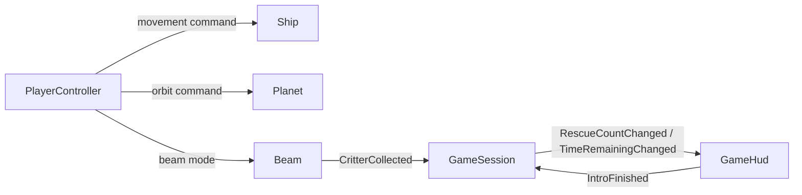

# Script responsibilities

The rescued total is session state. The ship's old `CargoCount` was a second
copy of the beam's total, and `CargoLabel` made an actor responsible for a HUD
node. Both are now removed from Ship; the beam also no longer stores a total.
`GameSession.RescuedCount` is the single source of truth.

## Ownership

| Component | Owns | Communicates through |
| --- | --- | --- |
| `PlayerController` | Keyboard/mouse actions and focus-loss input cleanup | Commands to Ship, Planet, and Beam |
| `Ship` | Vertical velocity, altitude limits, sprite sizing and hover animation | `SetVerticalInput(direction)`; an explicit Planet reference |
| `Beam` | Captured targets, hold/absorb physics and cone collision | `SetMode(mode)`; `Hit` and `CritterCollected(creature)` signals |
| `BeamVisuals` | Cone drawing, pulse/streak animation, held halo and intake flash | Receives dimensions, colors, mode and halo coordinates from Beam |
| `BeamGeometry` | Terrain-clipped reach and shared trapezoid calculations | Stateless functions used by Beam and BeamVisuals |
| `GameSession` | Rescued total, remaining mission time, theoretical arrival | State-change signals; no actor or UI references |
| `GameHud` | Cargo/time labels, colors, intro presentation notifications | Observes GameSession; emits `IntroFinished` |
| `Planet` | Authored terrain, surface queries, habitat lookup and rotation | `SetOrbitInput(direction)` and surface query methods |
| `Critter` | Creature placement, movement and appearance | Commands from its brain and beam |
| `CritterBrain` | Idle/wander/return-home decisions | Movement commands to its Critter |
| `CritterSpawner` | Population creation, limits, replenishment and wrapper cleanup | Species/habitat/spawn resources |
| Resource profiles | Editable species, habitat and spawn settings | Data consumed by the above components |

These are concrete components with clear jobs. Ship still needs terrain height
to avoid clipping the ground, and Beam still needs Critter's detach/land methods.
Those dependencies express physical gameplay. They do not give either actor
ownership of scoring, a mission clock, or labels.

BeamVisuals is a child at the beam's local origin, assigned through its exported
`Visuals` reference. Beam supplies presentation values; the visual component never
reads a creature, planet, session or input action. Removing it leaves capture and
rescue events functional. BeamGeometry is a plain C# helper, not another scene
node. Both detection and drawing use its cone corners, so their shapes stay aligned.
Existing beam Inspector settings remain on Beam to preserve scene overrides.

## Main-scene wiring

`GameManager.tscn` is the composition point. Dependencies are exported node
references visible in the Inspector, rather than cross-scene `GetNode` searches.
The scene also connects these signals:



The collection connection calls `GameSession.RecordRescue()`. It unbinds the
signal's creature argument because the current scoring rule only needs one
rescue per completed capture. Future species-specific scoring can use that
argument through an appropriate session rule or adapter.

GameSession starts paused. Hiding the intro makes GameHud emit `IntroFinished`;
the scene connects that event to `StartSession()`. UI code formats the clock,
while session code advances it and emits `ArrivalDue` exactly once. Reaching
zero still represents theoretical arrival; destruction is not implemented.

GameHud subscribes to state changes in `_Ready` and disconnects in `_ExitTree`.
Removing the HUD leaves the session functional. No autoload or global beam flag
is needed by the active game.

## Folder layout

```text
scripts/
  actors/
    ship/       Ship.cs, Beam.cs
      beam/     BeamVisuals.cs, BeamGeometry.cs
    critters/   Critter.cs, CritterBrain.cs
  data/         SpeciesProfile.cs, HabitatProfile.cs, CritterSpawnProfile.cs
  gameplay/     GameSession.cs
  input/        PlayerController.cs
  spawning/     CritterSpawner.cs
  ui/           GameHud.cs, ShowTitle.cs
  world/        Planet.cs
  debug/        WorldSetup.cs, CritterDebug.cs
  legacy/       Preserved prototype scripts, including the old countdown/Globals
```

Folders organize by responsibility; namespaces remain compatible. Existing
script `.uid` files moved with their scripts, and scene/resource paths were
updated. `legacy/` preserves earlier experiments for reference rather than
using them in the main game. `PickupZone` remains available to its prototype
scene. The old Globals autoload was removed from project settings.

## Runtime order and reuse

Physics priorities apply commands and movement in this order:
`PlayerController (-30)`, `Planet (-20)`, `Ship (-10)`, `Beam (-5)`, then default
priority nodes such as GameSession and Critter. The beam therefore sees the
ship's updated position and the planet's updated rotation each frame.

Ship and Beam do not poll input themselves. An AI, replay, or test can call
`SetVerticalInput`, `SetOrbitInput`, and `SetMode` directly. Disable or replace
PlayerController when another system controls those same actors; otherwise its
next physics tick supplies the player's commands. The standalone ship scene is
an actor scene, and needs a controller in a playable scene.

The current rescued total represents mission progress. If physical cargo slots,
mass, or unloading are added later, a ship inventory component may own that
physical state; it should still not own a HUD Label.

## API changes for collaborators

| Previous API | Current API |
| --- | --- |
| `Ship.CargoCount`, `Beam.CollectedCount` | `GameSession.RescuedCount` |
| `Ship.CargoLabel` | `GameHud.CargoLabel` |
| `CritterCollected(creature, total)` | `CritterCollected(creature)`; session computes totals |
| Countdown Label's `ArrivalSeconds`, `SecondsRemaining`, `HasArrived` | Same fields/properties on GameSession |
| `Globals.Instance.IsBeamActive` | The relevant `Beam.IsActive` or `Beam.Mode` |
| Actor scripts reading Input actions | PlayerController issuing actor commands |

The HUD child names, control bindings, beam colors, movement settings, population
settings and authored terrain are preserved. New Ship component references and
Beam collision/planet references are assigned in the scenes.

See [beam-and-ship.md](beam-and-ship.md) for every function's purpose and the
control-to-collection sequence. Source functions also have plain comments describing their purpose.